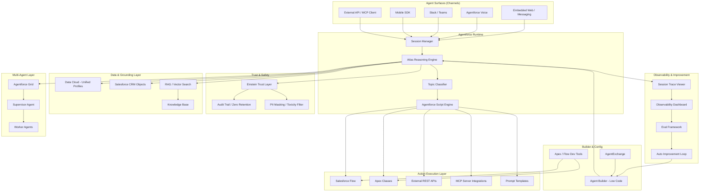

# Agentforce Architecture

## System Overview

Agentforce is built natively on the Salesforce Platform. Agents are defined, deployed, and monitored within Salesforce orgs. The platform orchestrates LLM calls through the Atlas Reasoning Engine, grounds responses via Data Cloud, executes deterministic actions through Flow and Apex, and enforces trust through the Einstein Trust Layer — all within a single, multi-tenant cloud environment.



---

## Core Components

### Atlas Reasoning Engine
The central AI orchestration layer. Receives each user turn, classifies intent against configured Topics, selects the appropriate Action chain, handles multi-turn memory within a session, and decides when to escalate to a human agent. Supports both ReAct-style iterative reasoning and Agentforce Script for deterministic paths.

### Agentforce Script
A hybrid execution model. Engineers define "scripts" that mix deterministic logic (conditionals, lookups, guaranteed action sequences) with LLM calls for natural language understanding and generation. This allows precise control over critical workflows (e.g., payment processing, identity verification) while retaining conversational flexibility.

### Einstein Trust Layer
Sits between the Reasoning Engine and all LLM calls. Performs:
- **PII Detection & Masking** — strips sensitive data before it leaves the org
- **Toxicity Filtering** — blocks harmful inputs and outputs
- **Zero-Retention Enforcement** — ensures LLM providers do not store or train on Salesforce data
- **Audit Logging** — records every LLM call, input hash, and output for compliance

### Data Cloud Grounding
Agents retrieve real-time customer context from Data Cloud Unified Profiles via RAG (Retrieval-Augmented Generation). Vector search indexes are built on Knowledge Articles, CRM records, and external data sources. Grounding is the primary mechanism for ensuring factually accurate, personalized responses.

### Agentforce Grid (Multi-Agent)
Orchestration layer for multi-agent workflows. A Supervisor Agent receives a complex goal, decomposes it into sub-tasks, routes each to a specialized Worker Agent, collects results, synthesizes outputs, and handles partial failures. Worker Agents can be any Agentforce agent or an external agent reached via MCP.

---

## Data Model

### Core Entities

| Entity | Description | Key Fields |
|--------|-------------|------------|
| **Agent Definition** | Configuration record for an agent | agent_id, name, description, topics[], default_actions[], instructions, channel_config |
| **Agent Topic** | Scoped area of expertise for an agent | topic_id, agent_id, name, description, scope_instructions, actions[] |
| **Agent Action** | Discrete task an agent can execute | action_id, type (Flow/Apex/API/Prompt), name, input_schema, output_schema, trust_level |
| **Agent Session** | A single conversation instance | session_id, agent_id, channel, user_id, start_time, end_time, status, escalated_to |
| **Session Turn** | One exchange within a session | turn_id, session_id, input_text, reasoning_steps[], actions_called[], output_text, latency_ms |
| **Session Trace** | Full reasoning log for a turn | trace_id, turn_id, topic_selected, actions_sequence[], data_retrieved[], llm_calls[], decision_points[] |
| **Eval Test Case** | Synthetic conversation for agent testing | test_id, agent_id, conversation[], expected_outcome, eval_dimensions[] |
| **Eval Result** | Outcome of running a test case | result_id, test_id, run_timestamp, scores{accuracy, helpfulness, safety}, passed, failure_reason |
| **Feedback Signal** | Human or system rating on a session | signal_id, session_id, source (CSAT/supervisor/auto), rating, tags[], notes |
| **Agent Deployment** | Channel-specific deployment config | deployment_id, agent_id, channel_type, routing_rules, escalation_config, active |

### Entity Relationships

```
Agent Definition ──< Agent Topic ──< Agent Action
Agent Definition ──< Agent Deployment (one per channel)
Agent Session >── Agent Deployment
Agent Session ──< Session Turn ──< Session Trace
Session Turn ──< Feedback Signal
Eval Test Case ──< Eval Result (per test run)
Agent Definition ──< Eval Test Case (agent owns its test suite)
```

---

## Integration Architecture

### Salesforce CRM Integration

```
┌─────────────────────────────────────────────────┐
│          Salesforce CRM Objects                  │
│  Accounts, Contacts, Cases, Opportunities,       │
│  Orders, Knowledge Articles, Custom Objects      │
└─────────────────────────────────────────────────┘
              │
              v
┌─────────────────────────────────────────────────┐
│         Agentforce Runtime (same org)            │
│  - Native SOQL/SOSL access via Actions           │
│  - No API boundary — direct object access        │
│  - Named Credentials for external auth           │
└─────────────────────────────────────────────────┘
```

### Data Cloud Grounding (RAG)

```
┌─────────────────────────────────────────────────┐
│              Data Cloud                          │
│  Unified Profiles │ Vector Indexes │ Segments    │
└─────────────────────────────────────────────────┘
              │  (semantic search at runtime)
              v
┌─────────────────────────────────────────────────┐
│          Atlas Reasoning Engine                  │
│  - Retrieves top-k relevant chunks               │
│  - Injects into LLM context window               │
│  - Cites sources in agent response               │
└─────────────────────────────────────────────────┘
```

### MCP Server Integration

```
Agentforce Agent --> MCP Client (Salesforce) --> MCP Server (external tool)
                                                  (e.g., Jira, Confluence, SAP, custom API)
```

MCP (Model Context Protocol) is how Agentforce connects to external tools and data sources without custom connectors. Each MCP Server exposes a set of tools the Reasoning Engine can call as Actions.

### AgentExchange

```
Admin / Developer --> AgentExchange --> Install Action Package
                                        --> Surfaces as available Action in Agent Builder
                                        --> Configures via Named Credentials or OAuth
```

---

## Event & Session Architecture

### Session Lifecycle Events

| Event | Description | Consumers |
|-------|-------------|-----------|
| `session.started` | New agent conversation initiated | Analytics, Observability, Billing |
| `session.turn.completed` | Single turn processed by agent | Session Trace, Analytics |
| `session.escalated` | Agent handed off to human | Service Cloud, Omni-Channel, Analytics |
| `session.resolved` | Agent resolved without escalation | Analytics, Feedback Loop |
| `session.ended` | Session closed (resolved or timed out) | Analytics, Billing, Feedback |
| `action.called` | Agent invoked a specific action | Trace, Audit, Observability |
| `action.failed` | Action returned an error | Observability, Alerting |
| `eval.run.completed` | Eval test suite finished | Eval Dashboard, CI/CD gate |
| `agent.deployed` | Agent config pushed to a channel | Audit, Observability |

### Billing Events

Agentforce Flex Credits are consumed per conversation. A conversation = one `session.started` to `session.ended` event pair. Billing is metered and surfaced in the Salesforce Usage dashboard.

---

## Module Dependency Map

```
┌───────────────────────────────────────────────────────┐
│            Observability & Auto-Improvement            │
│  (reads sessions, traces, eval results, feedback)      │
├───────────────────────────────────────────────────────┤
│            Evaluation & Testing Framework              │
│  (depends on Agent Definition, Session structure)      │
├──────────────────────┬────────────────────────────────┤
│   Multi-Agent Grid   │   Agent Runtime + Tracing       │
│   (depends on        │   (core execution layer)        │
│    Agent Runtime)    │                                 │
├──────────────────────┴────────────────────────────────┤
│            Atlas Reasoning Engine                      │
│  (core module — all other layers depend on this)       │
├───────────────────────────────────────────────────────┤
│     Einstein Trust Layer  │  Data Cloud Grounding      │
│     (cross-cutting)       │  (cross-cutting)           │
└───────────────────────────────────────────────────────┘
```

**Dependency rules:**
- Atlas Reasoning Engine is the foundation. Nothing works without it.
- Einstein Trust Layer and Data Cloud Grounding are cross-cutting; they intercept every LLM call and every retrieval.
- Agent Runtime + Tracing requires the Reasoning Engine and Trust Layer.
- Multi-Agent Grid requires Agent Runtime (it orchestrates multiple runtime instances).
- Evaluation Framework requires Agent Definition + Session structure to generate and score test runs.
- Observability & Auto-Improvement is read-only from all layers; it has no write path except feeding back to Agent Builder config.

---

## Deployment Architecture

### Salesforce Infrastructure

| Component | Salesforce Service | Notes |
|-----------|--------------------|-------|
| Compute | Salesforce Platform (Hyperforce) | Multi-tenant, auto-scaling, region-selectable |
| LLM Execution | Einstein AI (hosted models + partner models) | Zero-retention contracts with providers |
| Data Store | Salesforce Objects (CRM DB) | Encrypted at rest, tenant-isolated |
| Vector DB | Data Cloud Vector Index | Used for RAG grounding |
| Session State | In-memory session store | Cleared on session end |
| Event Bus | Salesforce Platform Events | Async inter-service communication |
| Audit Logs | Einstein Trust Layer Audit | Immutable, queryable via SOQL |
| File Storage | Salesforce Files / Content | Documents, KB articles |
| CDN | Akamai (via Salesforce) | Static assets |

### Trust Zones

- **Org Data Zone** - CRM objects, Data Cloud profiles, Knowledge Articles. Never leaves the Salesforce org boundary.
- **LLM Call Zone** - Inputs are PII-masked by Einstein Trust Layer before reaching any LLM. Zero-retention enforced.
- **External Action Zone** - Calls to external APIs (via Named Credentials, MCP, REST). Governed by Named Credential policies and action trust levels.
- **Audit Zone** - All LLM calls, action invocations, and data retrievals are logged. Accessible to compliance admins.

### Multi-Tenancy

Each Salesforce org (customer) gets:
- Isolated object storage (standard Salesforce multi-tenancy)
- Org-scoped agent definitions, sessions, traces, and eval results
- Configurable Einstein Trust Layer policies per org
- Independent usage metering and Flex Credit consumption tracking

---

## API Design Patterns

### Agent Invocation (External)
- REST API: `POST /services/data/v63.0/einstein/ai-agent/sessions`
- Streaming responses via Server-Sent Events (SSE)
- Authenticated via OAuth 2.0 (Connected App) or Session ID

### Versioning
- Salesforce API versioning: `v[major].[minor]` (e.g., `v63.0`)
- Agent API follows Salesforce API lifecycle (3-release deprecation window)

### Rate Limiting
- Standard: governed by Salesforce API governor limits per org
- Agentforce sessions: configurable concurrency limit per deployment
- Flex Credit metering: real-time deduction per session start

### Pagination
- List endpoints use standard Salesforce SOQL offset or cursor patterns
- Session Trace query results: cursor-based, max 200 records per page
